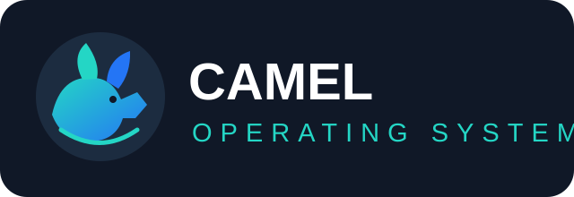

<div align="center">



# 🐪 CAMEL-OS

### A desktop-inspired Android operating environment.

**One Android device. A complete workspace.**

[](https://developer.android.com/)
[](https://kotlinlang.org/)
[](https://gradle.org/)
[](#)
[](#roadmap)

[Features](#-features) · [Applications](#-built-in-applications) ·
[Architecture](#-how-it-works) · [Build](#-build-from-source) ·
[Roadmap](#-roadmap)

</div>

---

## 🌌 About CAMEL-OS

CAMEL-OS is an Android-based desktop-style environment designed to bring a
computer-like workspace to a mobile device.

The project combines a native Android foundation with a collection of
integrated applications and a desktop-inspired interface.

The goal is simple: make a smartphone feel more like a personal computer,
while keeping Android hardware, permissions and services available underneath.

CAMEL-OS is an evolving project. Some capabilities depend on device support,
Android permissions, network access and the maturity of individual apps.

## ✨ Features

| Feature | Description |
|---|---|
| 🖥️ Desktop environment | A desktop-inspired workspace running on Android. |
| 🪟 App windows | A foundation for launching and managing multiple applications. |
| 🧩 Integrated apps | Built-in web applications packaged with the Android project. |
| 📁 App ecosystem | A common environment for the included tools and utilities. |
| 📷 Device integration | Native Android permission and hardware integration. |
| 🗺️ Location and maps | Mapping experience with network and location dependencies. |
| 🎙️ Media tools | Camera, gallery, music and recording applications. |
| 🐧 Linux direction | A project path toward Linux environments on Android. |
| 🎨 Custom interface | A customizable visual workspace designed for mobile screens. |

> Features are under active development. This table describes project
> functionality and direction, not a guarantee that every feature is fully
> operational on every device.

## 📦 Built-in applications

CAMEL-OS includes a growing collection of integrated applications.

| Icon | Application | Purpose |
|---|---|---|
| 🧮 | Calculator | Everyday calculations. |
| 🧭 | Compass | Direction and orientation tools. |
| 📅 | Calendar | Date and schedule management. |
| 📷 | Camera | Camera interface and capture experience. |
| 🖼️ | Gallery | Browse images and video media. |
| 🕒 | Clock | Time and clock utilities. |
| ℹ️ | System Info | Device and system information. |
| 🐧 | Linux Loader | Linux environment launcher interface. |
| 🗂️ | Manager | Application and workspace management. |
| 🗺️ | Maps | Map and location experience. |
| 🎵 | Music | Music playback interface. |
| 📝 | Notes | Notes and text organization. |
| 📻 | Radio | Radio interface. |
| 🎙️ | Recorder | Audio recording interface. |
| 📺 | TV | Television and video interface. |

The application catalog will continue to evolve as more integrations are
completed. Independent projects such as GassNative remain separate products.

## 🏗️ How it works

CAMEL-OS combines two layers:

### 1. Native Android foundation
- Android application lifecycle and activities.
- Native permissions and device capabilities.
- Kotlin-based application code.
- Android services and system integration.

### 2. Integrated application environment
- Applications packaged in the project's assets.
- Web-based application interfaces.
- Shared desktop-style application experience.
- Native-to-web integration where supported.

This approach allows the project to combine native Android capabilities
with a flexible application ecosystem.

## 📱 Designed for mobile

CAMEL-OS is being developed with high-density smartphone displays in mind.

Design priorities include:

- High-DPI and 480-DPI display support.
- Responsive layouts for different screen sizes.
- Touch-friendly controls.
- Desktop-style panels adapted to mobile screens.
- Efficient use of available display space.

## 🔐 Permissions and privacy

Some features require Android permissions, including camera, microphone,
location, media and file access.

CAMEL-OS should request permissions when needed and explain why a feature
requires them.

Never publish private credentials, signing keys, access tokens or personal
configuration files in the repository.

## 🛠️ Build from source

### Requirements

- Android device or development environment.
- Android SDK.
- JDK compatible with the project's Gradle configuration.
- Git.

### Clone

```bash
git clone https://github.com/Gass-OS/CAMEL-OS-.git
cd CAMEL-OS-
```

### Configure Android SDK

Create or update `local.properties` with your own SDK location.

Example:

```properties
sdk.dir=/path/to/your/android-sdk
```

Do not commit local machine configuration.

### Build the APK

On a configured development machine:

```bash
./gradlew assembleDebug
```

The APK is normally generated under:

```text
app/build/outputs/apk/debug/
```

Build requirements can change as the project evolves. Use the Gradle wrapper
and project configuration supplied by the repository.

## 🧭 Roadmap

- [x] Native Android project foundation.
- [x] Desktop-inspired application environment.
- [x] Integrated application assets.
- [x] Initial GitHub project publication.
- [ ] Refine multi-window and application switching.
- [ ] Improve permission onboarding.
- [ ] Complete native camera integration.
- [ ] Improve online map functionality.
- [ ] Complete media upload and playback integration.
- [ ] Expand Linux environment integration.
- [ ] Improve high-density display adaptation.
- [ ] Continue testing across Android devices.

## 🤝 Contributing

Ideas, bug reports and improvements are welcome.

Before contributing:

1. Check the existing project structure.
2. Preserve existing applications and working functionality.
3. Keep credentials and private configuration out of commits.
4. Test changes before submitting them.
5. Prefer incremental improvements over destructive rewrites.

## 👨‍💻 Project

**Created by Aymen Gharsalli**

Organization: [Gass-OS](https://github.com/Gass-OS)

Repository: [Gass-OS/CAMEL-OS-](https://github.com/Gass-OS/CAMEL-OS-)

---

<div align="center">

### 🐪 CAMEL-OS
**A new kind of mobile workspace.**

*Built with curiosity. Developed step by step.*

</div>
